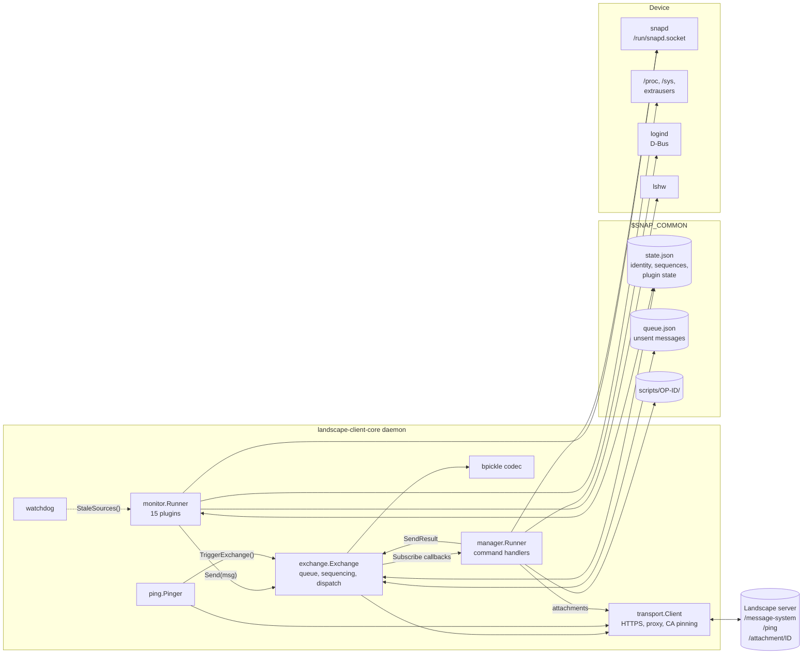
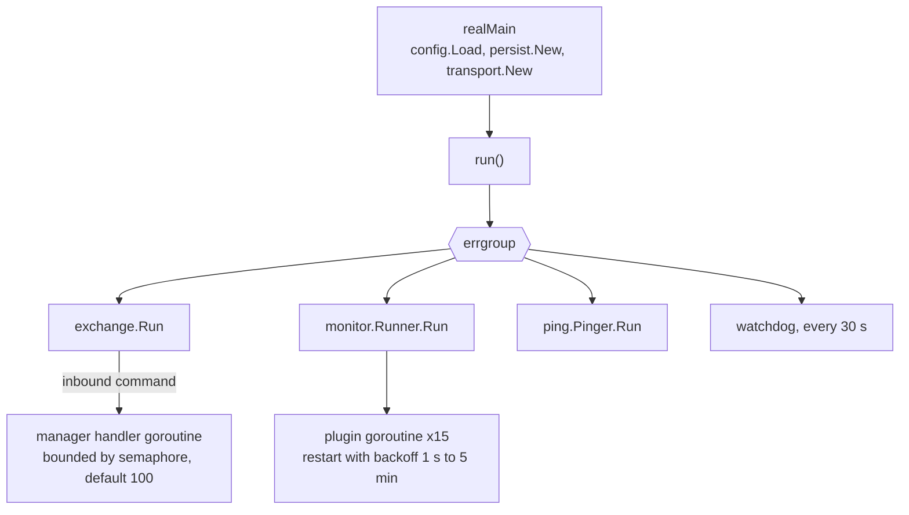
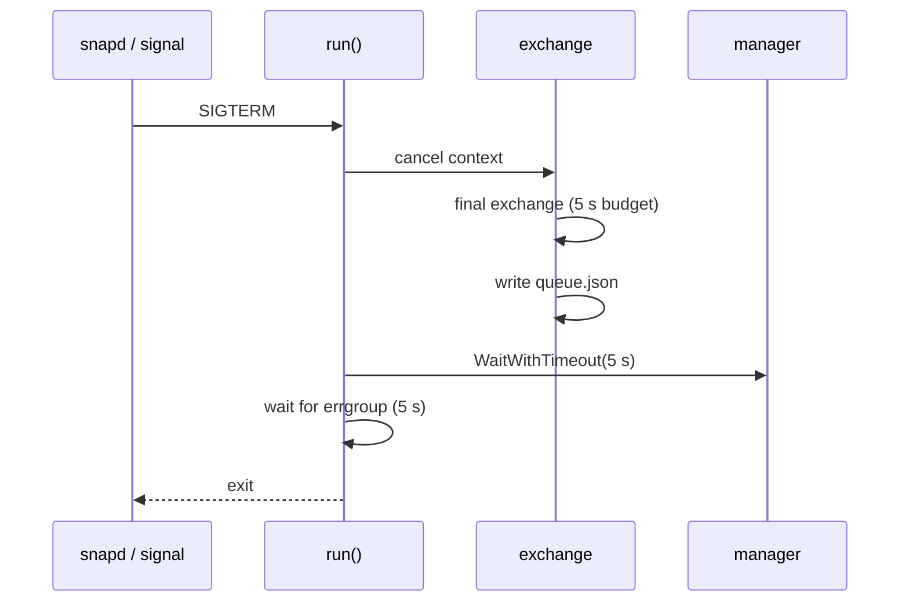
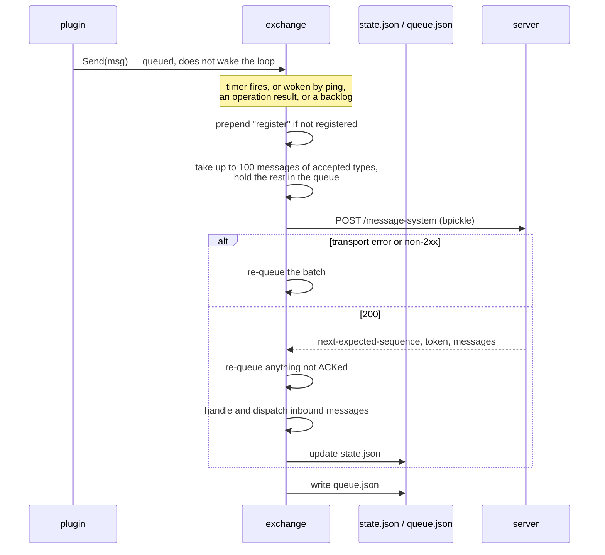
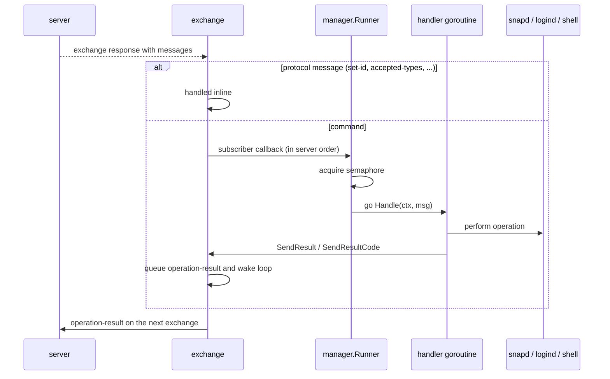
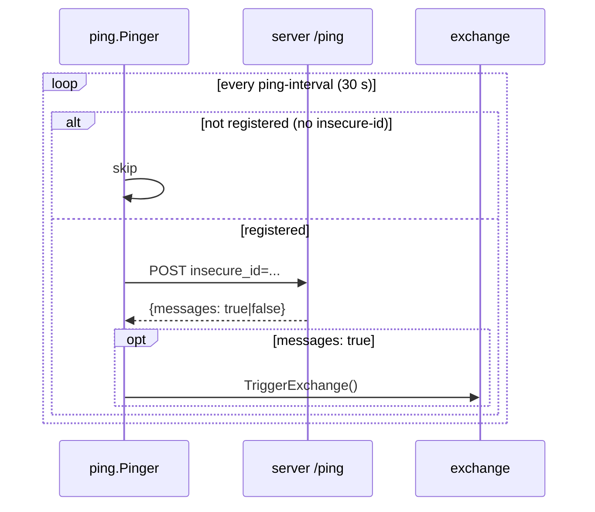
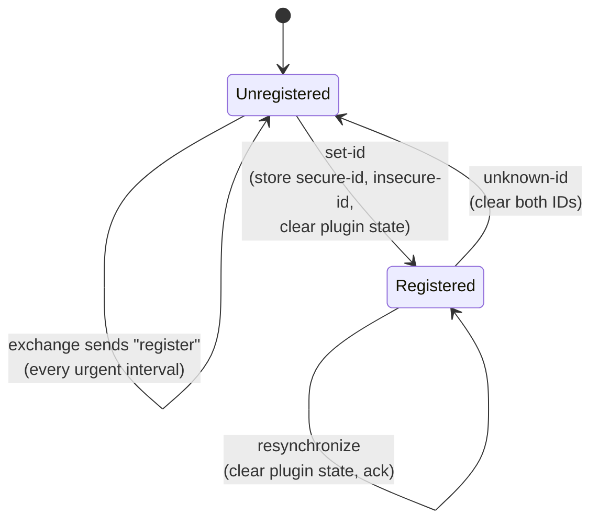

# Architecture

`landscape-client-core` is one daemon process (`cmd/landscape-client-core`)
plus an interactive configuration wizard (`cmd/landscape-client-core-config`).
The daemon talks to the Landscape server over HTTPS and to the device through
snapd, procfs/sysfs, logind and `lshw`.

## Components

| Package | Responsibility |
|---|---|
| `cmd/landscape-client-core` | Loads config, wires every component, runs them, handles `SIGTERM`/`SIGINT`. Also implements the `--validate-config` and `--sync-confdb` modes used by the configure hook. |
| `cmd/landscape-client-core-config` | Interactive wizard that writes all settings in one `snapctl set`. |
| `internal/config` | Reads snap config through `snapctl get`, applies defaults, validates. |
| `internal/exchange` | Outbound queue, message sequencing, registration, the exchange loop, inbound dispatch. |
| `internal/monitor` | Plugin runner and the 15 telemetry plugins. |
| `internal/manager` | Handlers for inbound commands (snaps, services, shutdown, scripts, cancel). |
| `internal/ping` | Cheap periodic poll that wakes the exchange when the server has messages. |
| `internal/transport` | HTTP client: TLS 1.2+, optional custom CA, proxies, timeouts, response size cap. |
| `internal/bpickle` | Encoder/decoder for Landscape's wire format. |
| `internal/persist` | Atomic JSON state file with backup recovery. |
| `internal/snapd` | Minimal snapd REST client over the Unix socket. |
| `internal/runcmd` | Runs external commands with a timeout. |
| `internal/version` | Version string and `User-Agent`, injected at build time. |

## Goroutines and lifecycle

`run()` in [main.go](../cmd/landscape-client-core/main.go) starts four
long-lived goroutines in an `errgroup`. If any of them returns an error the
group context is cancelled and the process exits non-zero, so snapd's
`restart-condition: on-failure` restarts it.

- **Monitor plugins** each run in their own goroutine. A plugin that returns an
  error or panics is restarted after a backoff that starts at 1 s and doubles to
  a 5 min cap. The backoff resets after a run that lasted at least 30 s.
- **Manager handlers** run one goroutine per command. A weighted semaphore caps
  concurrency (`--handler-concurrency`, default 100) and a `WaitGroup` tracks
  them for shutdown.
- **Watchdog.** Every plugin records a heartbeat on each tick. Every 30 s the
  watchdog flags any plugin that has not beaten for `max(3 × interval, 2 min)`.
  A stale plugin means a goroutine is wedged (for example blocked in a
  syscall), so the daemon exits non-zero and snapd restarts it.

### Shutdown

## Outbound: telemetry to the server

The next exchange is scheduled as follows:

| Condition | Delay |
|---|---|
| Default | `exchange-interval` (900 s) |
| An `operation-result` is queued, the device is not registered, or it has just registered | `urgent-exchange-interval` (60 s) |
| The server returned 429 or 5xx | Backoff of 5 min doubling to 2 h, plus up to 20% jitter, if longer than the above |
| Messages are still queued after a successful exchange | Immediately |

The in-memory and on-disk queue is capped at 1,000 messages. When it overflows
the oldest telemetry is dropped first; operation results are never dropped.

## Inbound: commands from the server

Protocol messages handled inside the exchange are listed in
[protocol.md](protocol.md#messages-handled-by-the-exchange). Commands handled
by the manager are in [management-commands.md](management-commands.md). A
`set-intervals` message is handled by a subscriber in `main` that updates the
ping interval.

## Ping

## Registration

## Persistent state

All files live in `$SNAP_COMMON` (`/var/snap/landscape-client-core/common`).

| File | Contents | Written by |
|---|---|---|
| `state.json` | `secure_id`, `insecure_id`, `server_uuid`, `outbound_sequence`, `next_expected_from_server`, `exchange_token`, `accepted_types`, `accepted_types_hash`, `plugin_state` | exchange after every exchange; plugins via `SetPluginState` |
| `state.json.old` | Previous good copy, used if `state.json` is corrupt at load | every save |
| `queue.json` | Unsent outbound messages | exchange after every attempt and at shutdown |
| `scripts/<operation-id>/` | Script and attachments while a script runs; removed afterwards | `execute-script` handler |

Every write goes to a temp file, is `fsync`ed and then renamed over the target.
All writes to `state.json` are read-modify-write under one mutex, so the
exchange and plugins never overwrite each other's fields.

## Snap packaging

[snapcraft.yaml](../snap/snapcraft.yaml) defines:

- **`landscape-client-core`** — the daemon. Installed disabled
  (`install-mode: disable`); the configure hook enables it once configured.
  Runs with `GOMEMLIMIT=64MiB` and `GOMAXPROCS=2`.
- **`config`** — the wizard.
- **Plugs:** `network`, `snapd-control`, `system-observe`, `hardware-observe`,
  `shutdown`, `log-observe`, `mount-observe`, plus two confdb custodian plugs
  (`landscape-client-admin`, `landscape-client-state`).
- **Hooks:** `install`, `post-refresh`, `configure`, and
  `change-view-landscape-client-admin`. See
  [configuration.md](configuration.md#snap-hooks).

Under strict confinement the daemon runs as root and cannot switch users, so
the `username` field of `execute-script` is ignored.
