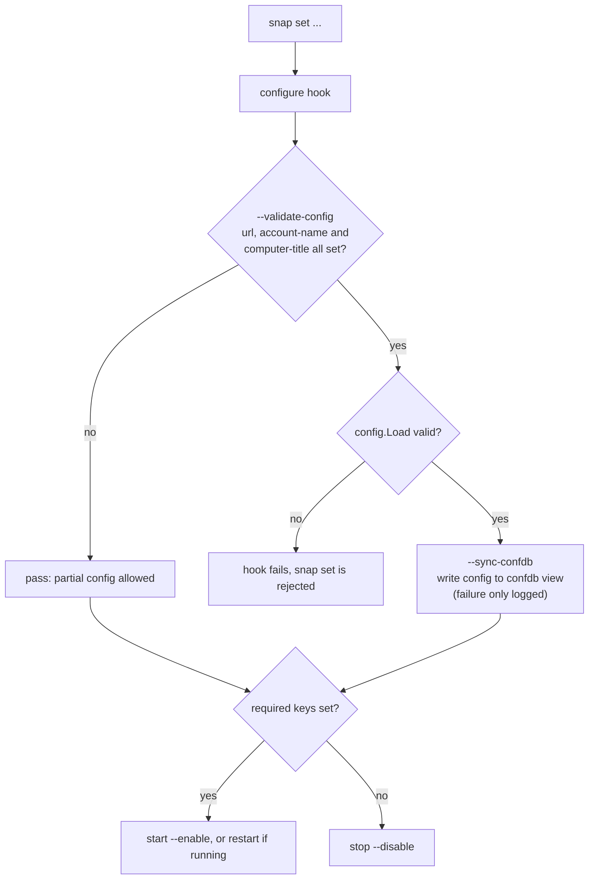

# Configuration

Configuration is snap configuration: set it with `snap set`, read it with
`snap get`. The daemon reads each key with `snapctl get` at startup, so changes
take effect when the configure hook restarts it.

## Keys

| Key | Required | Default | Description |
|---|---|---|---|
| `url` | yes | — | Message-system URL, e.g. `https://landscape.canonical.com/message-system`. Must start with `http://` or `https://`. |
| `account-name` | yes | — | Landscape account name. |
| `computer-title` | yes | — | Name shown in the Landscape dashboard. |
| `registration-key` | no | — | Account registration key, if the account requires one. |
| `exchange-interval` | no | `900` | Seconds between regular exchanges. |
| `urgent-exchange-interval` | no | `60` | Seconds between exchanges while unregistered or while an operation result is waiting. |
| `ping-interval` | no | `30` | Seconds between pings. |
| `ping-url` | no | derived | Ping endpoint. Defaults to `http://<host of url>/ping`. |
| `ssl-public-key` | no | — | Path to a PEM CA bundle. Replaces the system CAs. The daemon refuses to start if it cannot be read. |
| `http-proxy` | no | — | Proxy for `http://` requests. |
| `https-proxy` | no | — | Proxy for `https://` requests. |
| `access-group` | no | — | Landscape access group, sent at registration. |
| `tags` | no | — | Comma-separated tags, sent at registration. |
| `log-level` | no | `info` | `debug`, `info`, `warn`/`warning`, or `error`. |

Intervals are non-negative integers in seconds. The `install` and
`post-refresh` hooks write the three interval defaults if they are unset.

If neither proxy key matches a request's scheme, the standard
`HTTP_PROXY`/`HTTPS_PROXY`/`NO_PROXY` environment variables apply.

## Setting configuration

```bash
sudo snap set landscape-client-core \
  account-name=my-account \
  computer-title="My Device" \
  url=https://landscape.canonical.com/message-system
```

Self-hosted server with a private CA:

```bash
sudo cp my-ca.crt /var/snap/landscape-client-core/common/
sudo snap set landscape-client-core \
  account-name=standalone \
  computer-title="My Device" \
  url=https://landscape.example.com/message-system \
  ssl-public-key=/var/snap/landscape-client-core/common/my-ca.crt
```

### Wizard

`sudo landscape-client-core.config` asks for:

1. Hosted or self-hosted. Self-hosted asks for the server's domain and builds
   `url` as `https://<domain>/message-system`.
2. Computer title and account name (required).
3. Registration key, entered twice without echo (optional).
4. HTTP and HTTPS proxies, access group, and tags (optional). Each tag must
   match `[a-zA-Z0-9][a-zA-Z0-9-]*`.

It shows a summary, then writes every non-empty value in one `snapctl set` so
the configure hook only ever sees a complete configuration, and restarts the
daemon.

## Snap hooks



| Hook | Behaviour |
|---|---|
| `install`, `post-refresh` | Set `exchange-interval=900`, `urgent-exchange-interval=60`, `ping-interval=30` if unset. |
| `configure` | Validate, publish to confdb, then start, restart or stop the daemon (diagram above). Validation only runs once all three required keys are set, so keys can be set one at a time. |
| `change-view-landscape-client-admin` | Rejects confdb writes whose `config.url` does not start with `http://` or `https://`. |

The daemon is installed disabled. Without the required keys it would exit
non-zero and crash-loop under `restart-condition: on-failure`.

## confdb

When the configuration is complete and valid, the configure hook runs
`landscape-client-core --sync-confdb`. This writes the whole configuration as
one JSON object to the `config` path of the confdb view
`landscape-client/client-admin` through the `landscape-client-admin` custodian
plug. Interval keys are written as integers, all other keys as strings, and
empty keys are omitted.

The daemon still reads its configuration from snap config, not from confdb.
The `landscape-client-state` plug is declared but not yet used by the code.

## Reading configuration

```bash
snap get landscape-client-core
snap get landscape-client-core url
```

Runtime state (device identity, sequence numbers, queued messages) is kept
separately in `$SNAP_COMMON`; see
[architecture.md](architecture.md#persistent-state). Do not edit those files.
