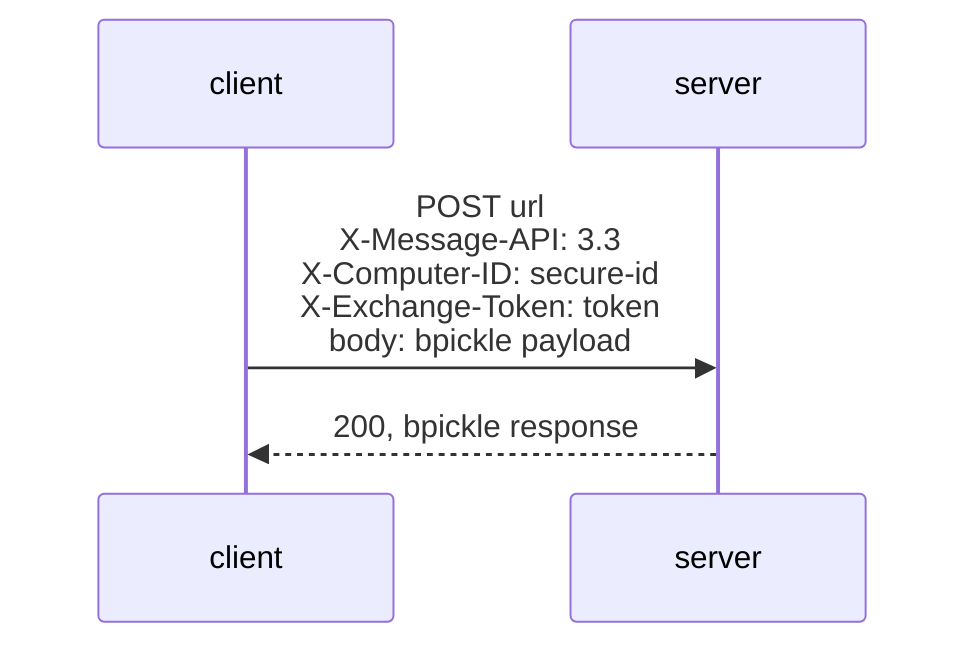

# Wire protocol

The client speaks Landscape message API `3.3`. Every request and response body
is bpickle-encoded except the ping request, which is a form POST.

## bpickle

bpickle is Landscape's compact, Python-compatible serialisation format
([internal/bpickle](../internal/bpickle/bpickle.go)).

| Go value | Encoding | Example |
|---|---|---|
| `nil` | `n` | `n` |
| `bool` | `b0` / `b1` | `b1` |
| any integer type | `i<decimal>;` | `i42;` |
| `float32`, `float64` | `f<repr>;` (whole numbers keep `.0`) | `f3.0;` |
| `[]byte` | `s<len>:<bytes>` | `s5:hello` |
| `string` | `u<len>:<utf-8>` | `u5:hello` |
| `[]any` | `l<items>;` | `li1;i2;;` |
| `bpickle.Tuple` | `t<items>;` | `ti1;f0.5;;` |
| `map[string]any` | `d<key><value>...;` with `u` keys | `du4:typeu8:register;` |
| `bpickle.BytesDict` | `d<key><value>...;` with `s` keys | `ds4:typeu8:register;` |

Dict keys are sorted, so output is deterministic. When decoding, both `s` and
`u` keys become Go `string`s, and tuples become `[]any`. Decoding stops at a
nesting depth of 100.

## Exchange



### Request

Headers:

| Header | Value |
|---|---|
| `Content-Type` | `application/octet-stream` |
| `User-Agent` | `landscape-client/<snap version>`. The server uses this to decide snap-monitoring support. |
| `X-Message-API` | `3.3` |
| `X-Computer-ID` | Secure ID. Omitted until registered. |
| `X-Exchange-Token` | Token from the previous response, if any. |

Body (a dict):

| Key | Value |
|---|---|
| `server-api`, `client-api` | `"3.3"` |
| `sequence` | Sequence number of the first message in this batch |
| `next-expected-sequence` | Number of server messages received so far |
| `accepted-types` | MD5 hash of the server's accepted-types list (empty until received) |
| `client-accepted-types` | Sorted list of inbound types the client handles. Sent only while there is no accepted-types hash. |
| `messages` | Up to 100 outbound messages |
| `total-messages` | Number of messages in this batch |

Once the server has sent `accepted-types`, outbound messages of other types are
held in the queue and sent once a later `accepted-types` includes them.
`register`, `resynchronize` and `operation-result` are always sent.

### Response

| Key | Effect |
|---|---|
| `next-expected-sequence` | Server ACK. Messages at or after it are re-queued and resent. |
| `next-exchange-token` | Stored and sent as `X-Exchange-Token` next time. |
| `messages` | Inbound messages, processed in order. |

A non-2xx status re-queues the whole batch. 429 and 5xx also start the
exchange backoff described in
[architecture.md](architecture.md#outbound-telemetry-to-the-server). Responses
are capped at 4 MiB and redirects are not followed.

### Messages handled by the exchange

| Type | Effect |
|---|---|
| `set-id` | Store `id` as secure ID and `insecure-id`; clear all plugin state so plugins report in full. |
| `accepted-types` | Store `types` and their hash (`md5(";".join(types))`, in server order). |
| `resynchronize` | Clear plugin state; queue a `resynchronize` reply carrying the `operation-id`. Sequence numbers are kept. |
| `unknown-id` | Clear both IDs; the next exchange registers again. |
| `registration` | Log. `unknown-account` and `max-pending-computers` are logged as failures. |
| `registration-complete` | Log. |

Every other type goes to its subscribers; see
[management-commands.md](management-commands.md). `set-intervals` is
subscribed in `main` and updates the ping interval from its `ping` field.

## Registration

While the state has no secure ID, each exchange puts this message at the front
of the batch:

```go
map[string]any{
    "type":                  "register",
    "api":                   "3.3",
    "account_name":          cfg.AccountName,
    "registration_password": cfg.RegistrationKey,
    "computer_title":        cfg.ComputerTitle,
    "hostname":              os.Hostname(),
    "machine_id":            "<contents of /etc/machine-id>",
    "tags":                  cfg.Tags,
    "access_group":          cfg.AccessGroup,
}
```

The server answers with `registration` (pending or failed) and eventually
`set-id`.

## Ping

```
POST <ping-url>
Content-Type: application/x-www-form-urlencoded

insecure_id=<insecure-id>
```

The response is a bpickle dict. If `messages` is `true`, the client starts an
exchange immediately. No ping is sent until the device has an insecure ID.

## Attachments

`execute-script` attachments are fetched one by one:

```
GET <url with last path segment replaced by attachment/><id>
X-Computer-ID: <secure-id>
```

For example `https://landscape.canonical.com/message-system` gives
`https://landscape.canonical.com/attachment/42`. The body is the raw file.

## Timeouts

Connections and TLS handshakes time out after 30 s. A whole request times out
after 600 s.
