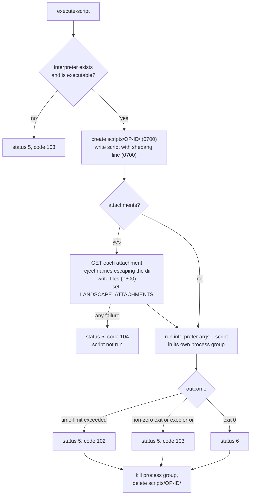

# Remote script execution

`execute-script` runs a script sent from the Landscape dashboard
([internal/manager/system.go](../internal/manager/system.go)). Scripts run as
root: under strict confinement the client cannot switch users.

## Command fields

| Field | Required | Description |
|---|---|---|
| `operation-id` | yes | Identifies the result. |
| `code` | yes | Script body, without a shebang. |
| `interpreter` | no | Interpreter path, optionally with arguments (`/usr/bin/env python3`). Default `/bin/sh`. |
| `time-limit` | no | Timeout in seconds. `0` or absent means none. |
| `attachments` | no | Map of file name to attachment ID. |
| `username` | no | Ignored; a warning is logged. |

## Flow



## Result codes

| `status` | `result-code` | Meaning | `result-text` |
|---|---|---|---|
| 6 | — | Exit code 0 | Output |
| 5 | 102 | `time-limit` exceeded | Output so far |
| 5 | 103 | Non-zero exit | Output plus `exit status N` |
| 5 | 103 | Interpreter missing, not executable, or could not start | Error message |
| 5 | 104 | Attachment fetch failed or file name escapes the working directory | Error message |

## Output

Stdout and stderr are merged into one buffer capped at 5 MiB. Once the cap is
reached `\n**OUTPUT TRUNCATED**` is appended once and the rest is discarded.
Invalid UTF-8 is replaced with U+FFFD so the result can be encoded as a bpickle
string.

## Processes

The script runs in its own process group. On timeout, cancellation
(`cancel-operation`) or normal exit, the whole group gets `SIGKILL`, so
background children do not outlive the operation. `Wait` is bounded to 5 s
after the kill in case something still holds the output pipe.

## Attachments

Attachments are downloaded before the script starts from
`<server>/attachment/<id>` with the device's secure ID in `X-Computer-ID` (see
[protocol.md](protocol.md#attachments)). They are written next to the script,
and `LANDSCAPE_ATTACHMENTS` is set to that directory:

```bash
cat "$LANDSCAPE_ATTACHMENTS/my-config.txt"
```
